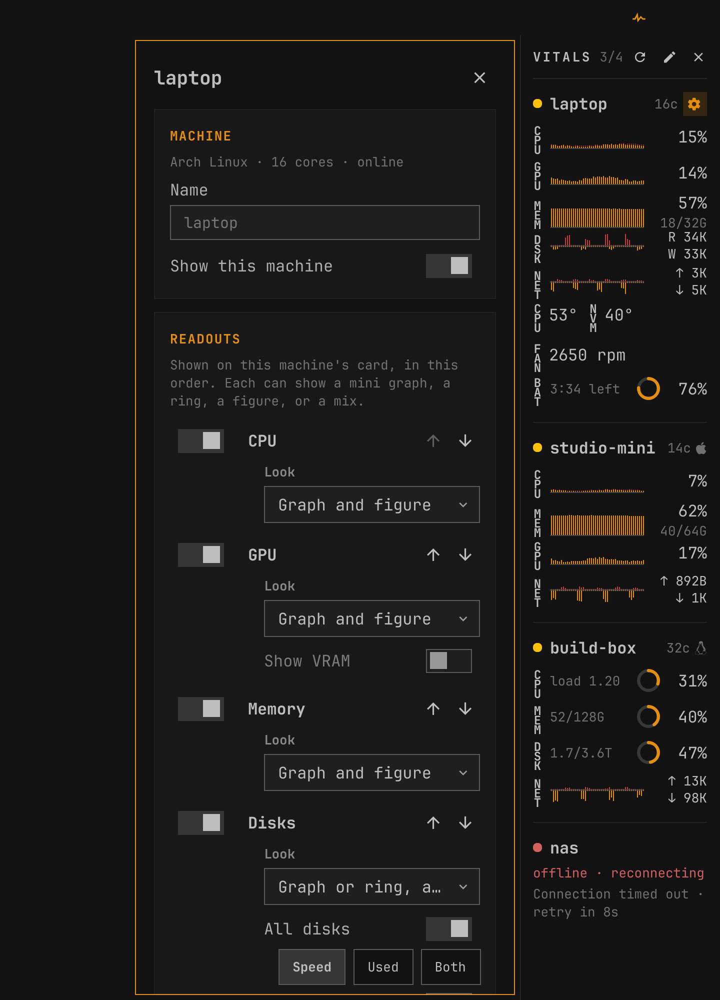
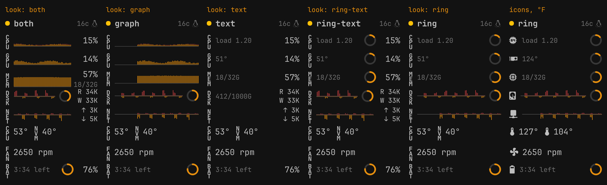
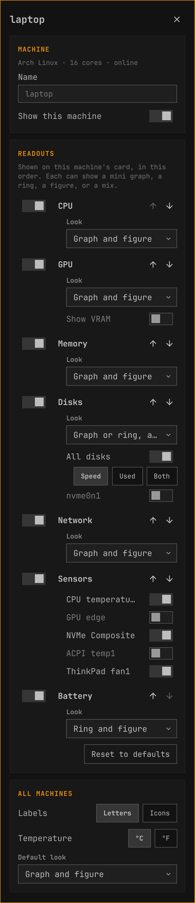

# Vitals for Omarchy

A compact system monitor for several machines at once. Vitals shows CPU, GPU,
memory, disks, network, sensors and battery for this machine and for any other
machine you can reach over SSH, and you choose which of those each machine shows.
It sits in a narrow sidebar docked to a screen edge, or in its own window. The
remote side needs nothing installed: a small shell script is streamed over SSH
and runs with the tools every Linux and macOS system already has.

The readouts follow [OmaStats](https://github.com/crmne/omastats): the same
modules, the same looks (graph, ring, figure, or a mix), stacked letter labels
or icons, and colors taken from your Omarchy theme, so Vitals looks at home
beside OmaStats in the bar. Each machine's settings page is modeled on OmaStats'
own.



## What it shows

Each machine gets a compact card: a status dot, the machine's name, its core
count and an OS glyph, then one row per readout you picked for it, in your
order. Hover the header and the OS glyph turns into a gear that opens that
machine's settings.

| Readout | What it shows |
|:--|:--|
| **CPU** | Usage history (user and system stacked), a ring, the percentage; load average beside a ring |
| **GPU** | Load history and percentage per GPU; a GPU that reports no load (Intel) shows its clock instead. Optional VRAM readout |
| **MEM** | Used memory history, the percentage, and used/total |
| **DSK** | Per disk, or all disks together: read above the midline and write below it with rates, and/or a ring for space used |
| **NET** | Upload above the midline and download below it, with current rates |
| **Sensors** | The temperatures and fans you pick, each with its own label |
| **BAT** | A ring for the charge, the percentage, and time left or time to full |

Every readout takes one of the OmaStats looks: **graph**, **ring**, **figure**,
**graph and figure**, or **ring and figure** (rings only where a fill level
means something). Labels can be stacked letters or icons, and temperatures °C
or °F.



A readout a machine can't report is left off its card, never filled in: a
desktop has no battery row, a machine without a GPU no GPU row. The status dot
uses the theme's colors: online, connecting or stale, offline. A machine that
can't be reached shows **offline · reconnecting**, the reason (for example
"Host not found" or "SSH key not accepted"), and a countdown to the next try.
Vitals never shows numbers it doesn't have.

The cards stay legible at 180 to 220 pixels wide. With more machines than fit,
the sidebar scrolls.

### What each readout uses

| Readout | Linux | macOS (no root) |
|:--|:--|:--|
| CPU | `/proc/stat` | `iostat` (whole percents) |
| Memory | `/proc/meminfo`, total minus available | `vm_stat`: app memory plus wired plus compressed, as Activity Monitor counts it |
| Network | `/proc/net/dev`, interfaces backed by a real device | `netstat -ibn`, `en*` interfaces |
| GPU | AMD: `gpu_busy_percent`, VRAM and temperature from sysfs. NVIDIA: `nvidia-smi`. Intel: clock only (the kernel reports no load) | Apple GPU load from `ioreg` IOAccelerator "Device Utilization %", plus GPU memory in use |
| Disks | `/proc/diskstats` per whole disk; space from `df`, mapped through partitions, LUKS and LVM to the disk underneath | Read and write from `ioreg` IOBlockStorageDriver, all disks together; space of the startup volume's container from `df` |
| Sensors | Every hwmon temperature and fan (`/sys/class/hwmon`), plus "CPU temperature" for the CPU package | Battery temperature (MacBooks) |
| Battery | `/sys/class/power_supply` (the system battery, not mice or headsets) | `ioreg` AppleSmartBattery |

A GPU that runtime power management has put to sleep is reported as idle
without being woken, and its sensors are skipped, so a laptop's dGPU stays
asleep.

## Requirements

- Omarchy with the Quickshell-based `omarchy-shell`.
- For remote machines: `ssh` on this machine, and key-based login to each remote
  that already works without a prompt (see [Remote machines](#remote-machines)).

Nothing else. No packages, agents or daemons on either side.

## Install

```sh
omarchy plugin add https://github.com/SuperCleanse/omarchy-vitals.git --enable
```

This puts the Vitals pulse icon in the right section of your bar. Click it to
open the sidebar. Move the icon with
`omarchy bar move supercleanse.vitals --section right`, or drag it.

Update later with `omarchy plugin update supercleanse.vitals`, then run
`omarchy-restart-shell`. Vitals keeps its service and SSH sessions running
across the shell's hot reloads, so new code takes effect on a restart.

### Manual install

```sh
git clone https://github.com/SuperCleanse/omarchy-vitals.git ~/.config/omarchy/plugins/supercleanse.vitals
omarchy-shell shell rescanPlugins
omarchy plugin enable supercleanse.vitals
```

### Remove

```sh
omarchy plugin remove supercleanse.vitals
rm -rf ~/.config/vitals ~/.local/state/vitals   # machine list and open/closed state
```

## Using it

| Action | Result |
|:--|:--|
| Click the bar icon | Show or hide Vitals |
| Middle-click the bar icon | Reconnect any offline machine now |
| Right-click the bar icon | Open Vitals in edit mode |
| Refresh button in the sidebar | Reconnect any offline machine now |
| Pencil button | Edit the machine list |
| Gear on a card's header | Open that machine's settings |

In edit mode each machine has a checkbox to switch it on or off, buttons to
move it up or down, open its settings or remove it, and an **Add machine**
button below the list. The local machine can be renamed and switched off but
not removed. Its name defaults to the short hostname.

### A machine's settings

The settings page follows OmaStats' Settings page, control for control. In
dock mode it opens in a popout beside the sidebar; in window mode it takes the
window's place until you close it.

- **Machine.** Its name and SSH destination, and whether it is shown.
- **Readouts.** A switch per readout the machine has, in card order, with
  buttons to move it up or down and a **Look** for each. Disks list every disk
  the machine reported plus "All disks", each showing speed, space used, or
  both. Sensors list every temperature and fan it reported. A machine with
  several GPUs lists them, and **Show VRAM** adds a memory readout per GPU.
  Readouts the machine doesn't have are listed underneath with the reason, such
  as "No battery".
  **Reset to defaults** returns the machine to the default readouts.
- **All machines.** Letters or icons for labels, °C or °F, and the default look.

Changes apply and save straight away. A machine that has never connected offers
every readout until its first report says what it has.



### IPC and keybinding

```sh
omarchy-shell supercleanse.vitals toggle    # show or hide
omarchy-shell supercleanse.vitals open
omarchy-shell supercleanse.vitals close
omarchy-shell supercleanse.vitals dock      # switch to the docked sidebar and show it
omarchy-shell supercleanse.vitals window    # switch to window mode and show it
omarchy-shell supercleanse.vitals refresh   # reconnect anything offline, reread machines.json
omarchy-shell supercleanse.vitals edit      # show in edit mode
omarchy-shell supercleanse.vitals settings local   # open a machine's settings by id
omarchy-shell supercleanse.vitals status    # JSON: every machine, its state and latest figures
```

`dock` and `window` save the choice as the widget's `mode` setting in
`shell.json`, so it sticks. To bind a key, add this to
`~/.config/hypr/bindings.lua`:

```lua
o.bind("SUPER + SHIFT + M", "Vitals", "omarchy-shell supercleanse.vitals toggle")
```

## Display modes

- **dock** (default). A layer-shell panel pinned to the left or right edge,
  below the bar. It reserves its width as an exclusive zone, so Hyprland tiles
  your windows beside it instead of under it. Like the bar, it is on every
  workspace. It only takes keyboard focus while the add/edit form is open.
- **window.** The same content in an ordinary window, which Hyprland tiles like
  any app. Its class is Quickshell's, `org.quickshell`, and its title is
  `Vitals`, for window rules:

  ```lua
  o.window({ class = "^org.quickshell$", title = "^Vitals$" }, { float = true })
  ```

  Closing the window hides Vitals.

## Settings

Set these in the shell's settings for the Vitals bar widget, or inline on its
entry in `~/.config/omarchy/shell.json`.

| Key | Default | Meaning |
|:--|:--|:--|
| `mode` | `dock` | `dock` or `window` |
| `edge` | `right` | Dock edge: `right` or `left` |
| `width` | `200` | Sidebar and window width in pixels (160 to 360) |
| `screen` | `""` | Output for the dock, such as `DP-1` (see `hyprctl monitors`). Empty lets the compositor choose, usually the focused screen |
| `refreshSeconds` | `"2"` | Sample interval: 1, 2, 3, 5 or 10 seconds |
| `historySeconds` | `120` | How much history the graphs keep (30 to 900) |
| `sampleWhileHidden` | `false` | Keep sampling while Vitals is hidden. Graphs then have history when you open it, and the bar icon turns the theme's danger color when a machine drops off |
| `barReadout` | `icon` | `icon`, or `count` to add online/total beside the icon while sampling |
| `modules` | `cpu,memory,network` | Default readouts, in order, for machines without their own |
| `style` | `both` | Default look: `graph`, `ring`, `text`, `both` or `ring-text` |
| `barLabels` | `text` | `text` for stacked letters, `icon` for glyphs |
| `temperatureUnit` | `Celsius` | `Celsius` or `Fahrenheit` |

Per-machine readouts live in `machines.json` (below) and override `modules`
and `style` for that machine.

By default Vitals only samples while it is visible. Hiding it closes every SSH
session.

## The machine list

Vitals keeps the list in `~/.config/vitals/machines.json` (it honors
`XDG_CONFIG_HOME`). The file is created on first run with just this machine.
The edit mode writes it for you, but it is plain JSON and safe to edit by hand.
Vitals rereads it when it changes.

```json
{
  "version": 2,
  "machines": [
    { "id": "local", "alias": "", "host": "", "enabled": true,
      "modules": ["cpu", "gpu", "memory", "disks", "network", "sensors", "battery"],
      "sensors": ["cpu", "nvme/temp1"] },
    { "id": "studio-mini", "alias": "studio-mini", "host": "studio-mini", "enabled": true },
    { "id": "build-box", "alias": "build-box", "host": "builder@100.101.102.103", "enabled": true,
      "modules": ["cpu", "memory", "disks", "network"],
      "styles": { "cpu": "ring-text", "memory": "ring-text" },
      "disks": [{ "disk": "all", "show": "used" }] },
    { "id": "nas", "alias": "nas", "host": "nas.example-tailnet.ts.net", "enabled": false }
  ]
}
```

- `id` is a stable key. Leave it out of a new entry and Vitals makes one up.
- `alias` is the name shown on the card. For the local machine, empty means the
  short hostname.
- `host` is any SSH destination. Empty means this machine, and there is always
  exactly one local entry.
- `enabled: false` keeps a machine in the list without showing or sampling it.
- The order of the list is the order of the cards.

Readout keys, all optional (a missing key follows the defaults):

| Key | Meaning |
|:--|:--|
| `modules` | Readouts in card order: `cpu`, `gpu`, `memory`, `disks`, `network`, `sensors`, `battery` |
| `styles` | Look per readout, such as `{ "cpu": "ring-text" }` |
| `disks` | `[{ "disk": "all" or a device like "nvme0n1", "show": "speed", "used" or "both" }]` |
| `sensors` | Sensor ids from the settings page, such as `cpu`, `nvme/temp1`, `dell_smm/fan1`, or `battery` on a Mac |
| `gpus` | `"all"` or a list of GPU ids (PCI addresses) |
| `showGpuMemory` | `true` to add a VRAM readout beside each GPU |

A version 1 file (from Vitals 0.1) is upgraded the first time Vitals reads it:
the machines keep their names and destinations, gain no readout keys, and so
follow the defaults. The original is kept beside it as `machines.v1.json`.

Vitals picks up edits made by hand, with any editor or `cat >`, without a
refresh. It waits out the moment a rewrite leaves the file empty, and it also
checks the file every few seconds in case a change slips past the watch.

If the file stops being valid JSON, Vitals keeps showing the last good list
with a note asking you to fix the file, and saves nothing to it until you do.

Whether Vitals is open is remembered in `~/.local/state/vitals/state.json`.

## Remote machines

Vitals runs your own `ssh` client like this, once per machine, and keeps the
session open:

```sh
ssh -T -o BatchMode=yes -o ConnectTimeout=8 -o ServerAliveInterval=10 \
    -o ServerAliveCountMax=2 -- <host> sh -s -- <interval>  < vitals-sampler.sh
```

So anything that works for `ssh <host>` works in Vitals: `~/.ssh/config`
aliases, `ProxyJump`, `ProxyCommand` (Cloudflare Tunnel's
`cloudflared access ssh`, for example), ports and identity files. Because of
`BatchMode=yes`, ssh never prompts. That means:

- **Key login must already work.** Test with `ssh -o BatchMode=yes <host> true`.
  Load your key into `ssh-agent` if it has a passphrase.
- **The host key must already be known.** Connect once by hand to accept it.
  Vitals shows "Host key not trusted yet" until you do.

An alias in `~/.ssh/config` keeps the destination short:

```
Host studio-mini
  HostName studio-mini.example-tailnet.ts.net
  User me
```

**Tailscale.** A MagicDNS name (`studio-mini` or
`studio-mini.example-tailnet.ts.net`) or a `100.x.y.z` address works directly
as the destination. Tailscale SSH works too, as long as it doesn't ask for
browser approval on each connection; check mode is a prompt, and Vitals can't
answer prompts.

When a connection drops, Vitals marks the machine offline and retries after 2,
4, 8 and 16 seconds, then every 30 seconds. ssh's keepalive notices a dead link
within about 30 seconds. A machine that goes quiet without disconnecting is
marked **stale** after three missed samples.

### macOS remotes

- Tested on macOS 26 (Apple silicon).
- Turn on **System Settings › General › Sharing › Remote Login**.
- Vitals uses only built-in tools: `iostat`, `vm_stat`, `netstat`, `sysctl`,
  `sw_vers`, `scutil`, and `ioreg` and `df` for the GPU, disk and battery
  readouts. Nothing needs root.
- Temperatures: the battery's, on MacBooks. Vitals reports only what macOS
  hands out without root, so a desktop Mac has no sensors readout.
- Memory "used" is App Memory plus Wired plus Compressed, the same figure
  Activity Monitor shows as Memory Used. It leaves out file cache, which
  `top`'s PhysMem counts.
- CPU is reported in whole percents, and the interval rounds to whole seconds.
- Network counts the `en*` interfaces, so Tailscale's `utun` traffic isn't
  counted twice.

### Linux remotes

- Tested on Arch Linux. The script uses only POSIX `sh`, `/proc` and `/sys`, so
  other distributions, including busybox-based ones, should work too.
- Network sums the interfaces backed by a real device in
  `/sys/class/net/*/device`, which leaves out loopback, bridges, veths, Docker
  and Tailscale. Inside a container, where nothing qualifies, it falls back to
  every non-loopback interface.
- Memory "used" is `MemTotal - MemAvailable`.

## How it works

- **One process per machine.** The local machine runs
  `sh sampler/vitals-sampler.sh <interval> <extras> <sensors>`. A remote one
  runs the ssh command above, with the same script streamed over stdin and the
  same arguments. Nothing is copied to or left on the remote machine. When
  Vitals stops a session, the remote loop exits on its next write.
- **Only what you show is sampled.** CPU, memory and network are always read;
  `extras` names the costlier readouts a machine has switched on (`gpu`,
  `disks`, `sensors`, `battery`) and `sensors` the sensor ids to read.
  Changing a machine's readouts restarts its sampler with the new list.
- **The sampler** is POSIX sh. It detects the OS with `uname`, prints a
  `hello` line (OS, hostname, core count, which readouts the machine has, and
  its GPUs, disks and sensors), then one JSON line per interval:

  ```json
  {"type":"sample","cpu":12.3,"user":8.1,"sys":4.2,"memUsed":13404160000,"memTotal":34359738368,"rx":5120,"tx":2048,"load":0.42,
   "gpus":[{"id":"0000:03:00.0","util":22,"mhz":1450,"temp":51.0,"memUsed":2684354560,"memTotal":8589934592}],
   "disk":{"read":81920,"write":40960,"per":{"nvme0n1":[81920,40960]},"space":{"all":[442381631488,1073741824000]}},
   "temps":{"cpu":52.5},"fans":{"thinkpad/fan1":2650},
   "battery":{"percent":76,"status":"Discharging","toEmpty":214,"toFull":null}}
  ```

- **Cost**, measured as CPU time per sample on the machines Vitals was tested
  with (Linux laptop, three Apple silicon Macs):

  | | Default readouts (CPU, memory, network) | All seven |
  |:--|:--|:--|
  | Linux | about 7 ms | about 15 ms |
  | macOS | 30 to 47 ms | about 85 to 90 ms |

  At the default 2-second interval that is under 1% of one core on Linux and
  about 2% (defaults) to 4.5% (everything) of one core on a Mac. On Linux the
  readouts read sysfs and `/proc` with shell builtins; `df` runs every 30
  seconds and `nvidia-smi` only when an NVIDIA GPU is awake. On macOS each extra
  readout adds one `ioreg` call; disk space (`df`) is read every 30 seconds and
  the battery every 10.
- **The service** (`VitalsService.qml`) owns the list, one connection per
  enabled machine, the sidebar or window, and the IPC target. It reconnects
  with backoff and keeps each machine's history in memory.
- **Colors** come from the active theme through `Commons.Color`. The graphs use
  the theme accent plus a second hue picked from the theme's `colors.toml`, the
  way OmaStats does, and follow theme changes live.

Vitals never stores passwords and never runs anything with elevated privileges.

## Development

Validate the manifest:

```sh
omarchy plugin validate .
```

Run the checks. None of them opens a window on your desktop.

```sh
dev/test-model.sh                     # unit tests for Model.js (needs node)
dev/test-sampler.sh                   # run the sampler here and check its output
dev/test-sampler.sh studio-mini       # ...and stream it to a remote too (read-only), every readout on
dev/render.sh --fake-data             # render every view to dev/renders/*.png
dev/render.sh --fake-data --theme tokyo-night
dev/load-check.sh /tmp/vitals-check studio-mini   # load the real plugin and sample for a few seconds
VITALS_MODULES=cpu,gpu,memory,disks,network,sensors,battery dev/load-check.sh /tmp/vitals-check studio-mini
VITALS_EDIT_TEST=1 dev/load-check.sh /tmp/vitals-check   # edit machines.json from outside while it runs
```

`dev/render.sh` runs a private Quickshell instance with
`QT_QPA_PLATFORM=offscreen`, its own runtime directory and no Wayland, Hyprland
or D-Bus connection, and saves each scene with `grabToImage`. It refuses to run
without `--fake-data`. Every number it draws comes from
`dev/harness/fixtures.js`. The plugin itself has no fake-data path: an
unreachable machine is shown as offline, never with made-up figures.

`dev/load-check.sh` loads the real service and widget with a scratch `HOME`,
lets the real samplers run, calls each IPC method on that private instance,
and saves one PNG of the live view to the scratch directory. It starts from a
version 1 `machines.json`, so every run also checks the upgrade to version 2.
`VITALS_MODULES` switches every machine to those readouts through the service;
`VITALS_EDIT_TEST=1` rewrites the file with `cat >` and with a rename and
checks each change is picked up. That PNG holds
real host data, so the script refuses to write inside the repository.

The docked sidebar's layer-shell behavior (the exclusive zone and tiling beside
it) and the settings popout's placement beside it need a running compositor.
Offscreen rendering can't show them, so check them on a live session.

## Credits

The look and several pieces are adapted from
[OmaStats](https://github.com/crmne/omastats) by Carmine Paolino (MIT): the
module set and looks, the settings page's layout and controls, the stacked
letter label, the bar-history and mirrored graphs, the ring gauge, the card and
section title, the byte, rate and temperature formatting, the sensor and GPU
selection, and the way it picks a second graph hue from the theme. See
`LICENSE` for both notices.

## License

MIT
